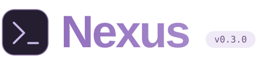

<p>
  
</p>

### Turn a task into code, right from your project terminal.

Nexus reads code, edits files, runs tools and keeps an inspectable conversation.
One hand-written, message-driven Agent Loop; optional subagents reuse that same loop.

Python 3.12+ · Windows / Linux · [MIT](LICENSE) · **English** / [简体中文](README.zh-CN.md)

**0.3.0 is a release candidate, not a published PyPI release.**
[Release notes](docs/next/release-0.3.0.md) · [Validation and CI](docs/next/release-0.3.0-validation.md)
· [User guide](docs/next/usage-guide.md)

## Quick start

Install the candidate from source in a dedicated environment:

```sh
git clone --branch codex/nexus-v0.3 https://github.com/K529529/Nexus.git
cd Nexus
python -m venv .venv
```

Activate it with `.venv\Scripts\Activate.ps1` in PowerShell, or
`source .venv/bin/activate` on Linux. Then:

```sh
python -m pip install -e .
python -m nexus --version
cd /path/to/your/project
nexus
```

The working directory is the project Nexus operates on. Its `AGENTS.md` supplies project
guidance. An editable install follows this checkout; keep the environment activated, or
use the absolute path to its `nexus` executable when working in another project.

On first interactive launch, the wizard asks for a model name, endpoint, context window
and **API-key environment variable name**. Settings live in `~/.nexus/config.toml`.
Set the named variable in the launching terminal; never put a key in chat or TOML:

```powershell
$env:NEXUS_MODEL_API_KEY = "<your key>"
nexus
```

Linux: `export NEXUS_MODEL_API_KEY="<your key>"`. For long sessions, configure a separate
compaction model too; the wizard's main-model configuration alone does not enable compaction.
See [configuration and upgrade](docs/next/usage-guide.md#configure).

Local execution is the default and uses your user permissions.
Memory is **on** by default and may download user-local Node/QMD and embedding models on
first use. Run `nexus memory off` before starting if you do not want this.
Multi-Agent, web tools and external tracing are **off** by default.

## Everyday use

| Action | Command / key |
| --- | --- |
| Interactive work / one task | `nexus` / `nexus exec "Fix the bug and run tests"` |
| Guide a running task | Type normally and press **Enter** |
| Queue the next root task | Type normally and press **Tab** while running |
| Inspect / change pending input | `/pending`, `/edit ID text`, `/withdraw ID` |
| Select an agent conversation | **F6**, `/agents`, or `/agents ID` |
| Return to root / browse archived agents | **Esc**, `/agent root` / `/agents history` |
| Read history / jump to latest | **PgUp**, **PgDn**, **Ctrl+End** |
| Newline / cancel | **F4** or **Alt+Enter** / **Ctrl+C** |
| Switch model / permissions | `/model` / `/permissions` |
| Resume / new conversation | `nexus resume`, `/resume` / `/new` |
| Memory / Skills / help | `/memory`, `/skills`, `/help` |
| Runtime events / profile | `nexus exec "task" --json` / `nexus --profile` |

Completion menus take precedence over Tab queueing. Enter in a child view guides that
child; Tab still queues a root task. Finished child views are read-only.
See [Multi-Agent configuration and boundaries](docs/next/stage8-usage.md).

## What 0.3 adds

- Continuous session context with an independent compaction model and deterministic
  execution facts; original JSONL history remains intact.
- Global Markdown memory, QMD retrieval, recoverable forgetting and session snapshots.
- Windows Native and Linux/WSL Docker restricted execution, explicit approval and durable
  tool checkpoints. Windows enforcement is partial; Local is unrestricted.
- Model aliases and switching, stdio MCP resources/tools, opt-in web tools and metadata-only
  OTLP tracing.
- Optional Fresh-context scout/worker/reviewer agents in a shared workspace, with explicit
  capacity, message delivery, cancellation, recovery and conversation views.

A completed Agent run is not proof that a candidate passes tests. Test evidence, platform
limits and historical failures are linked from the [release notes](docs/next/release-0.3.0.md).
The FeatureBench comparison stays pinned to `0fd7fa4`; release fixes are subsequent commits.
The DeepSeek Pro/high single-Agent batch is recorded as in progress, and the matching
Multi-Agent batch has not been started by this release work. No speed or quality gain is claimed.

## Documentation

- [User guide](docs/next/usage-guide.md): configuration, permissions, recovery, logs and shortcuts.
- [Architecture and code walkthrough](docs/next/engineering-walkthrough.md).
- [Development, packaging and release procedure](docs/next/development-and-release.md).
- [Local eight-case evaluation](evaluation/next-dev-v0/README.md): separate from ABK FeatureBench.
- [Historical 0.2.0 release](docs/next/release-0.2.0.md): historical installation and results.
