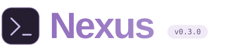

<p>
  
</p>

### 理解项目，编写代码，协作解决问题。

Nexus 是运行在终端里的 AI 编程助手。用自然语言描述任务，让它阅读项目、修改代码、
运行测试，并根据结果继续处理。复杂任务还可以交给多个 Agent 分工协作，
你随时可以查看进展、补充指导或排队下一项工作。

Python 3.12+ · Windows / Linux · [MIT](LICENSE)

[English](README.md) / **简体中文** · [快速开始](#快速开始) · [Multi-Agent](#multi-agent) · [使用手册](docs/next/usage-guide.zh-CN.md)

---

## 用 Nexus 做什么

| 能力 | 使用方式 |
| --- | --- |
| **从问题到修改** | 调查代码、修复缺陷、补充测试，在项目目录中完成一轮开发工作。 |
| **多个 Agent 分工** | 让 scout 调查、worker 实现、reviewer 审查，在同一工作区协作。 |
| **边运行，边沟通** | Enter 补充指导，Tab 排队后续任务，不必等当前任务结束。 |
| **接着上次继续** | 恢复历史会话；通过上下文压缩与长期记忆管理持续进行的工作。 |
| **接入你的工具** | 选择模型，通过 MCP 连接工具，使用 Skills 提供项目工作方法。 |
| **看清执行过程** | 查看工具结果、代理状态、会话记录和用量，按需开启运行统计与遥测。 |

## 快速开始

### 1. 安装

需要 Python 3.12+。推荐使用 [uv](https://docs.astral.sh/uv/) 安装独立 CLI：

```sh
uv tool install nexus-coding-agent==0.3.0
nexus --version
```

也可在自己的 Python 环境中运行 `python -m pip install --upgrade nexus-coding-agent==0.3.0`。

<details>
<summary>从源码安装（需要 Git）</summary>

创建独立环境：

```sh
git clone https://github.com/K529529/Nexus.git
cd Nexus
python -m venv .venv
```

激活环境：

```powershell
# Windows PowerShell
.\.venv\Scripts\Activate.ps1
```

```sh
# Linux
source .venv/bin/activate
```

安装并检查版本：

```sh
python -m pip install .
python -m nexus --version
```

</details>

### 2. 连接模型

运行 `nexus`，按首次启动向导填写模型名、Base URL、上下文窗口和 API Key 环境变量名。
配置保存在 `~/.nexus/config.toml`，可在不同项目间复用。

将密钥设置在启动 Nexus 的终端中，然后重新启动：

```powershell
# Windows PowerShell
$env:NEXUS_MODEL_API_KEY = "<你的密钥>"
```

```sh
# Linux
export NEXUS_MODEL_API_KEY="<你的密钥>"
```

支持 OpenAI-compatible、DeepSeek 和 DashScope 接入，可配置多个模型并通过
`/model` 切换。长会话建议同时配置独立压缩模型，见[模型与上下文配置](docs/next/usage-guide.zh-CN.md#配置)。

### 3. 在项目里开始工作

切换到要处理的项目目录；如果使用 pip 安装，保持对应 Python 环境激活：

```sh
cd /path/to/your/project
nexus
```

> 找到登录接口对空白用户名处理不一致的原因，修复它，补充回归测试并运行相关测试。

启动目录就是工作区，项目中的 `AGENTS.md` 可以提供编码规范和工作约定。
也可以直接执行单次任务：

```sh
nexus exec "梳理这个项目的入口、核心模块和测试运行方式"
```

<a id="multi-agent"></a>
## Multi-Agent 协作

把调查、实现和审查交给不同 Agent，并在同一个终端里跟进它们的工作。

| 角色 | 分工 |
| --- | --- |
| **scout** | 阅读代码、调查实现与测试，向主 Agent 返回发现。 |
| **worker** | 在分配的范围内编写代码、执行工具并验证修改。 |
| **reviewer** | 审查改动、检查边界情况，提出问题与建议。 |

Multi-Agent 默认关闭。在已有 `~/.nexus/config.toml` 中添加以下配置，重新启动即可开启：

```toml
[multi_agent]
enabled = true
max_agents = 3
allowNestedSubagents = false
```

例如，你可以这样安排工作：

> 并行调查登录流程和现有测试，汇总后修复问题，再让 reviewer 检查改动。

主 Agent 根据任务创建子代理、分配范围并汇总结果。每个子代理有独立的上下文与会话，
共享当前项目目录；可为不同角色配置模型、推理强度和 MCP 服务。
默认最多同时运行 3 个子代理，不包含主 Agent。

- **查看任务树**：按 F6 或输入 `/agents`，查看任务名、角色、短 ID 和状态。
- **进入子代理会话**：选择代理，或输入 `/agents ID`；直接输入并按 Enter 给它指导。
- **回到主 Agent**：按 Esc 或输入 `/agent root`。在子代理视图按 Tab，仍会给主 Agent 排队。
- **管理后续工作**：使用 `/agent cancel ID` 取消子树，`/agents history` 查看历史任务。

已完成的子代理会话保留为只读。共享工作区适合明确划分文件范围，
scout/reviewer 的职责分工不替代系统权限控制。
[查看角色配置、嵌套协作与权限说明 →](docs/next/usage-guide.zh-CN.md#多-agent)

## 顺手的终端交互

| 操作 | 快捷键 / 命令 |
| --- | --- |
| 指导正在运行的任务 | 输入内容，按 **Enter** |
| 排队下一项任务 | 运行中输入内容，按 **Tab** |
| 换行 | **F4** / **Alt+Enter** |
| 取消当前任务 | **Ctrl+C** |
| 阅读历史 / 回到最新 | **PgUp**、**PgDn** / **Ctrl+End** |
| 查看、编辑或撤回待处理输入 | `/pending`、`/edit ID 内容`、`/withdraw ID` |
| 切换模型 / 查看权限 | `/model` / `/permissions` |
| 恢复历史 / 新建会话 | `/resume` / `/new` |
| 查看帮助 / 退出 | `/help` / `/exit` |

支持多行编辑与粘贴；阅读历史时，新输出不会强制跳回底部。
补全菜单打开时，Tab 优先用于补全。更多操作见[使用手册](docs/next/usage-guide.zh-CN.md#命令与交互)。

## 按你的工作方式配置

**上下文与记忆。** 独立压缩模型整理较早的对话，保留近期工作内容。
长期记忆以本地 Markdown 保存，可通过 `/memory` 查看或切换；
默认开启，首次使用可能下载检索依赖与模型。不需要时可先运行 `nexus memory off`。

**工具与扩展。** MCP 连接已有工具服务，Skills 提供可复用的任务说明。
Web 工具和外部遥测均需显式开启。
[工具、Skills 与 MCP →](docs/next/usage-guide.zh-CN.md#工具skills-与-mcp)

**执行权限。** Local 默认使用当前用户权限；也可选择只读或工作区写入模式。
Linux/WSL 使用 Docker，Windows 使用 Native 后端。Windows 为部分强制隔离，
网络不受限；具体配置见[沙箱与审批](docs/next/usage-guide.zh-CN.md#沙箱与审批)。

**会话与记录。** 使用 `nexus resume` 继续历史会话，`nexus --profile` 查看运行统计，
`nexus exec "任务" --json` 输出 JSON 事件。
[恢复与日志 →](docs/next/usage-guide.zh-CN.md#恢复jsonl-与查看方式)

## 文档与参与

[完整使用手册](docs/next/usage-guide.zh-CN.md) ·
[架构与代码导读](docs/next/engineering-walkthrough.md) ·
[开发指南](docs/next/development-and-release.md) ·
[反馈问题](https://github.com/K529529/Nexus/issues)

Nexus 使用 [MIT License](LICENSE)。
