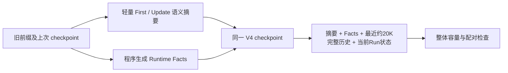

# Compaction Simplification & Deterministic Runtime Facts

日期：2026-10-22。开发分支：`codex/nexus-v0.3-stage1`。基线：`3aa0b746a8ebbb9e74b2bcef3f9680ec4cba7ba8`。

**结论：减掉引用账务提高了格式可用性；Runtime 接管执行回执提高了事实保留的确定性，但这 24 次样本尚未证明整体语义保真或任务接续质量明显改善。可提交独立源码审查，暂不宣称已满足后续无人监督执行的验收条件。**

这里不以“零信息损失”作为目标。用户明确要求判断丢失的信息是否有价值、剩余误差是否可接受。因此本文同时报告客观计数、逐例缺陷和主观接续判断；可接受的 PARTIAL 不被机械判成无用摘要。

## 1. 旧失败与本轮改动

上一轮 [保真专项](compaction-fidelity-hardening.md) 要求模型同时维护语义状态、字段索引、来源序号、逐项覆盖和旧条目更新凭据。Qwen 最终版结构通过 1/3，DeepSeek 后续同输入试验通过 3/3，但其 `PASSED ... failed with exit code 1` 反例证明合法引用不保证事实真实性。此前 DeepSeek 请求及返回均为 `deepseek-ai/DeepSeek-V4-Flash`，没有 `-0731` 后缀，不能将底层版本称为已确认的 0731。

本轮分两步冻结，没有看到失败后再追加付费调参：

- A：`ecae6f6`，轻量 First/Update，去掉模型输出的 evidence/updates。保持原输入 Serializer、全部原摘要字段。V3 checkpoint；实验原始证据冻结于 `63dc5ad`。
- B：`e0f78e8`，增加有界 Runtime Facts。模型不再输出 files_changes/validation_evidence，继续负责 goal、constraints_preferences、progress、key_decisions_rationale、unresolved_issues、next_steps。V4 checkpoint。

主 Agent、主模型配置、Thinking、温度、工具输出上限、连续 Session 和单 Loop 均未改变。没有新增 Judge、关键词验收器、事实数据库、HOT/COLD 或第二摘要路径。

旧 V2 校验代码只服务已有 checkpoint 的恢复，不再要求新模型产生来源数组。仍有效约束的保留与过期约束的撤销交给语义摘要，因此程序不再声称能够证明它们被正确理解。

## 2. Runtime 与 LLM 的职责

[`core/runtime_facts.py`](../../src/nexus/core/runtime_facts.py) 从已有消息配对与工具回执生成：

- tool name / call ID / call seq / result source seq / run ID；ok、error_code、原始 exit_code。
- 原生 exec_command 的 command、timeout/cancel/cleanup 标志、stdout/stderr 摘录。只区分 zero_exit、nonzero_exit、unknown_exit；不根据命令关键词判定“这是测试”，不将退出码自动升级成项目验收结论。
- 原生 apply_patch 已报告的路径、状态、before/after hash、partial/omitted_files；不把成功 patch 当作代码正确。
- Run outcome/reason，并明确它是生命周期信息、范围可能跨越当前摘要前缀。
- 旧摘要已有的文件/验证叙述作为 `legacy_summary_report` 保留，明确未独立验证；不会虚构原始失败回执。DE 的早期失败来自这种报告，后续 patch/pass 来自真实冻结消息回执。

LLM 仍负责用户意图与范围、技术决策、进度含义、问题和下一步。原始字段分工变少，并不使自然语言变成可信数据库。模型仍可能在 progress 或 constraints 等自由文本里产生错误，事实区段也不能自动修复用户意图误读。

## 3. 有界策略、恢复与失败保护

Facts 上限是估算 **2048 tokens**，包括标签和包装，独立于模型摘要 4096 上限。容量规划预留两者，压缩后再次核对完整主请求，因此不是免费增加 Context。128K 配置的 90% 阈值、约 20K 最近完整工具组不变；很小的窗口会保留更少近期组。

command、stdout/stderr 和旧报告采用最多 512 UTF-8 bytes 的摘录，明确 `[CLIPPED]`；先对已知密钥脱敏再裁剪。路径/hash 不截短：单条过大回执整体省略；剩余记录按来源顺序淘汰最旧项，累计 `omitted_records`。同一 Run 生命周期保留最新快照。没有按“重要性”猜测或编造任务结论。三例冻结输入中无 Facts 记录被淘汰。

因此会有真实损失：长输出尾部可能包含关键原因，早期回执可能被淘汰。这里的取舍是保留最近、可审计的执行事实，显式告知遗漏，必要时从原始 JSONL 追溯。这个固定上限是否适合长期真实会话，本轮小样本没有证明。

V1/V2/V3 仍可恢复，下一次写 V4；原 JSONL 不改写。V4 恢复检查 Facts 形状、来源序号形状及容量，保留历史工具配对与 checkpoint 替换引用检查。它不是对人为篡改日志的密码学认证，也不是自然语言真值证明。

checkpoint 仍是候选 Session 验证 → append/flush → 切换内存。失败保持原历史，provider overflow 仍有限恢复，主/压缩协议隔离。Facts 的旧快照经过复制，重复压缩不会就地改写已提交数据；私有 reasoning 不进入事实投影。

## 4. 实验控制及原始证据

按用户修正：**2 模型 × 3 案例 × 2 次 × 2 方案 = 24 次逻辑实验**。实际也是 **24 次物理请求**，无 transport/API 错误或重试；A 有一次正常返回后的 Schema 拒绝。完整失败响应仍保存。

模型：`Qwen/Qwen3.5-35B-A3B` 与 `deepseek-ai/DeepSeek-V4-Flash`，均通过硅基流动。响应 model 均与各自请求 ID 一致；不能进一步证明内部权重版本。两阶段 `enable_thinking=false`，未观察到 reasoning_content；4096 输出预算、120 秒超时、128K context_window、JSON object、stream 和原适配器均相同。不设置 reasoning_effort，不调用主模型。

temperature 始终省略，不同模型服务端默认行为可能不同。模型顺序跨重复次数反转，没有按输出优劣挑样本。每阶段请求在首个调用前冻结；同阶段两模型及两次重复使用完全相同的 messages SHA。A/B 的原始历史、previous_summary 逐值相同，原输入 SHA 不变：

| 案例 | Input SHA-256 |
| --- | --- |
| ABF-original | `4492b53ade3095a2682ad3a1402072df38a9c31a6194d6670db2a1026a5ffb20` |
| CDE-initial | `fe14d394e351f4c9c7dda7c4f4116b6ce8cffc049b3fcf0f300785c37c9cf8a4` |
| DE-update | `c6e3fc636c8e975408ebcdd9a601637be63cb637d8aece7e78ea37f80965ff37` |

A/B 比较的是“事实职责转移”整体方案：B 增加输入和接续 Context 的事实区段，同时移除两个 Runtime 所属输出字段。它不是只改变单个 Prompt 单词的消融，也没有独立测量字段减少和事实呈现各自的因果贡献。

执行器：[scripts/compaction_comparison.py](../../scripts/compaction_comparison.py)。默认 NOT_RUN，必须显式 `--run`；输出目录必须不存在。复现 A 需切至对应 A 提交，B 使用 `facts-v4` 源码；脚本检查阶段/Prompt 版本防止错误混用，不需要另一个生产 Runtime。

证据：[A manifest](evidence/compaction-simplification/stage-A/manifest.json)、[B manifest](evidence/compaction-simplification/stage-B/manifest.json)、[24 例人工复核](evidence/compaction-simplification/manual-review.json)。每例有 response.txt、result.json，结构通过时另保存实际组合后的 continuation-context.json；每阶段另存三个完整 request.json，B 还保存三个 Facts。Manifest 记录 Git、源文件 hash、输入/request hash 和固定顺序。人工判定另存，不覆写原输出。

## 5. 客观结果与主观接续判断

事实复核由实施者对照源消息与组合 Context 手工完成，不是外部独立裁判，没有让模型自评分。规则是运行后结合用户“信息价值与可接受损失”要求明确的，**主观可接受比例不是基准任务成功率，也不是预注册指标**。

- PASS：没有影响本例接续的重要错误或遗漏。
- PARTIAL：存在次要遗漏、分类/表达不准确或有限范围推断；另判断是否会把下一步带偏。
- FAIL：有效约束、权限、当前进展等高价值信息被错误改写，或输出无法被 Runtime 采用。
- “可接受”：本例 Context 可用于继续工作，仍须遵守保留的约束并检查实际回执；不意味着后续任务已真实验证成功。

| 方案/模型 | Schema | 事实 PASS / PARTIAL / FAIL | 主观可接受 | 6 次耗时合计 | reported input / output |
| --- | ---: | ---: | ---: | ---: | ---: |
| A / Qwen | 5/6 | 0 / 5 / 1 | 5/6 | 60.965s | 19126 / 1248 |
| A / DeepSeek | 6/6 | 1 / 3 / 2 | 4/6 | 26.217s | 19540 / 1864 |
| B / Qwen | 6/6 | 1 / 3 / 2 | 4/6 | 70.124s | 20964 / 1629 |
| B / DeepSeek | 6/6 | 1 / 3 / 2 | 4/6 | 28.981s | 21438 / 1111 |

合计 reported 86920 tokens；未核算金额，不以跨模型 token 数推导价格优势。每格只有六次观察，不做统计显著性、稳定成功率或线上收益宣称。

### 哪些信息损失可接受

- A/Qwen 的 DE 两例未完整保留早期失败，但最新修复动作、撤销权限和 focused pass 仍可用。我将其判为 PARTIAL 且可接受，没有因为遗漏旧失败就全盘否定。
- 检查次数“六次/七次”、摘要字段放置、旧事件的冗余表述，对下一步定位和修复的影响通常较小。只要关键约束与未完成工作仍清楚，可以接受，同时保留错误记录。
- B 的原始失败、patch 和 focused pass 在独立 Facts 中，即使模型没逐句复述，也不属于接续 Context 的信息丢失。ABF 的 limited/max_steps 同样由程序保留。
- B/Qwen/DE-2 的“all tests passed”措辞偏宽；同一 Context 仍明确保留 `pytest tests/test_demo.py` 与 `1 passed`。本文将其作为带范围注意事项的 PARTIAL，而不解释为全项目验收成功。独立审阅者可以对此作更严格判断。

### 哪些失真不可接受

- B/DeepSeek/DE-2 把已经撤销的只读限制当成当前有效限制，且重复旧的完成声明而没有更新语义进度。这会阻止合法后续工作，是高价值状态丢失。
- A/DeepSeek/CDE-1、B/DeepSeek/CDE-2 将“本次检查只读”缩窄为“仅 config.toml 只读”，可能导致不被当前范围允许的写操作。
- B/Qwen/ABF-1 虚构验证尝试和检查次数，把待定位、待修复的任务偏移为主要等待测试。Facts 虽保留实际回执，语义行动建议仍可能误导。
- A/DeepSeek/ABF-1、B/Qwen/CDE-2 给 NOT_RUN 状态添加用户“不执行测试”的意图。这不是压缩不可避免的细节损失。

其余全部样本的 missing_facts、unsupported_claims、判定理由、usage、延迟、错误与调用次数均在人工复核 JSON 中，无省略失败。

**我的主观结论：B 的职责划分和确定性事实保留值得保留；整体保真“明显改善”的证据仍不足。** A 的主观可接受为 9/12，B 为 8/12，差一个样本不能解释成稳定退化；同样不能用 B 的 12/12 Schema 或事实区段完整来宣称总体成功。特别是撤销限制失败会直接改变 Agent 行为，超过我认为可接受的误差范围。可以进入独立源码审查，但不应据此直接放行后续无人监督验收或扩大付费实验。

## 6. 工程复杂度和门禁

相对 `3aa0b74`：生产代码四个文件合计净增 184 行，其中独立 `runtime_facts.py` 为 182 行；离线测试净增 228 行，受控实验脚本 184 行。文档/原始证据另计。模型契约变简单了，程序代码总量没有减少，不能把复杂度转移包装成零成本。

新增的实际成本是有界回执投影、旧报告迁移、V3/V4 checkpoint 兼容和预算预留。旧 V2 引用验证仍需保留以读旧会话，没有额外数据库、服务、模型调用或后台事实维护任务。

验证结果：

- Windows：535 passed / 10 skipped。
- Linux CI：534 passed / 11 skipped；额外一个是 Windows 特定测试。
- Ruff、Mypy（73 个文件）、uv lock --check、sdist/wheel build 全部通过。
- [实现提交的 Windows/Linux CI](https://github.com/K529529/Nexus/actions/runs/39650076802) 两个 job 均成功，并执行独立 wheel/uv tool 安装检查。
- 首次本地全量出现一项小窗口历史组数量断言失败：新增 Facts 预算使保留组由二变一。已修正容量预期，并继续检查最后完整工具组、私有协议隔离和恢复一致性；第二次全量通过。
- 新测试覆盖 Runtime Facts 确定性、code/status 区分、重复 call ID、timeout/cancel/interrupted_unknown、patch receipt、逐字节裁剪/脱敏、超大回执淘汰、重复压缩、旧版本升级、快照不变性与容量失败。既有 checkpoint 写入失败、Resume、工具配对、provider overflow 和主 Agent 回归继续通过。
- 未执行按需 Docker 验收、Nexus 8 Case、完整 Dogfooding 或主模型付费运行；没有改动主模型配置。

仅向阶段分支提交/推送，不合入 `codex/nexus-v0.3` 或 `main`。本轮提交结果等待独立源码审查，不追加样本试到成功。
