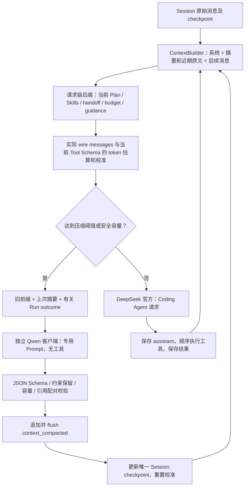

# V0.3 Stage 1：连续 Session Context Runtime

2026-10-22 用户授权的实施增量。此文替代旧 Stage 1 的有界 ConversationHistory、
Run 级压缩及 HOT/COLD 工具结果投影；其余单 Loop、工具执行、Plan/Skills 与恢复边界保留。
阶段分支为 `codex/nexus-v0.3-stage1`，不代表已合入 V0.3 主开发分支或发布。
实际验收与已发现问题见 [实施证据](context-runtime-v0.3-evidence.md)。
后续保真专项的设计、固定输入与全部失败记录见
[Compaction Fidelity Hardening](compaction-fidelity-hardening.md)。

## 1. 一个 Session，一条有效历史

Session 保存连续 user / assistant / tool 消息。普通输入创建新的执行 Run，重置预算、
Plan 和自动 Skills；Run 不再过滤可见消息。未压缩前，下个 Run 可以看到此前的中间
assistant 信息及完整 Tool Calls / Results。`/new` 开始独立 Session。
执行层工具输出仍有 32768 bytes 限制；“完整结果”指执行层实际保存的结果，并不恢复
命令输出已经被执行层截断的部分。之后不再按照 HOT/COLD 或消息年龄缩短结果。

`core/history.py` 只构建一个 Session 投影。原始历史不改写，checkpoint 之后的消息按
seq 续接。完整 assistant Tool Call 批次和全部对应 Results 是不可切开的消息组；
孤立结果、缺失结果或跨 Run 错配会拒绝。执行后崩溃的调用先由恢复层补充
`interrupted_unknown`，尚未派发的同批调用保持 `not_executed`，绝不为了压缩重放工具。

## 2. 配置和 API 边界

使用 [完整双模型 TOML](context-runtime-v0.3.toml)：`[model]` 与 `[compaction_model]`
复用 `ModelConfig` 字段，但独立解析、独立客户端、独立环境变量密钥和超时。
主模型为 DeepSeek 官方 `deepseek-flash`；压缩模型为硅基流动
`Qwen/Qwen3.5-35B-A3B`。主模型渠道以用户后续确认为准，原任务文档的百炼段落已被取代。

只在环境变量中设置 `DEEPSEEK_API_KEY` / `SILICONFLOW_API_KEY`，TOML 只写变量名称。
修改 Windows 用户环境变量后，已启动进程未必继承新值；重新打开终端/程序，或在启动
子进程前读入相应用户环境变量。程序不收集密钥明文、不读取仓库 `.env`，不改写全局配置。
配置按 Conversation 生命周期固定，换配置应新建 Conversation。

旧版仅 `[model]` 的配置仍可加载并执行容量内的任务，但启动给出缺少压缩模型的诊断；
到阈值会记录 `compaction_model_missing`，只有仍在安全容量内才继续。手动压缩或超限时
明确失败，不退回主模型生成摘要。已配置压缩模型但缺少其密钥则报告对应变量名。
环境覆盖分别为 `NEXUS_MODEL_NAME/BASE_URL`、`NEXUS_COMPACTION_MODEL_NAME/BASE_URL`。

硅基流动实测接受 `enable_thinking=false` 与 `response_format={type:json_object}`。
`enable_thinking` 是可选通用转发字段，未配置则不发送；不按模型名称猜测支持情况。
Qwen 示例不设 `reasoning_effort`，不假定它与 DeepSeek 的该参数同义。
`CompactionModel` 固定专用 System Prompt、只接受一个历史数据 user 消息，无 Tool Schema、
无 Coding Agent Prompt、无私有 `protocol_data`，拒绝工具响应和非正常结束。
压缩输出不进入主 Agent 的 assistant delta；只发布简短生命周期和用量事件。

## 3. 触发和保留范围

- 语义阈值是 `context_window × 0.90`：128000 对应 115200 tokens。
- `context_window` 是 Nexus 管理的输入窗口，不是 Provider 的真实容量。
  Stage 2 封版修正：`check`、历史保留量和压缩后容量检查统一使用该窗口，
  `max_output_tokens` 仅限制 API 输出，不从管理窗口扣减，不提前触发压缩。
  独立压缩模型的输入/输出容量检查、Provider overflow 的一次恢复仍保留。
- 近期目标是约 20000 tokens 的完整消息组，包含工具结果；优先 user 边界，
  否则完整 assistant/tool 批次边界。用户边界优先最多允许约 25% 目标偏差；单个不可拆组
  可能更大，最终仍须容量校验。System、动态状态与摘要预留过大时可降低目标，并记录实际值。
- 只摘要保留区之前的旧前缀；已有摘要作为单独的 previous_summary 参与增量合并。
  不重复处理已被 checkpoint 替换的原始消息，不把近期原文也送给压缩模型。
- 触发点：Run 内模型调用前、正常 completed 后等待输入前、用户 `/compact`、
  provider 报 context limit 后的一次压缩与一次重试。`/compact` 不创建 Coding Run、
  不调用主模型、不连接 MCP、不消耗 Step Budget。没有足够旧历史时保留原上下文并提示。
- Provider overflow 的一次恢复不受此前本地阈值压缩是否已执行影响；第二次 overflow 停止。

不能安全切分、固定指令过大、压缩输入超出压缩模型容量时明确停止，不隐藏截断或删掉用户
要求。这里不增加层级摘要、第二压缩器、记忆数据库或长期检索。

## 4. 摘要和持久化

当前 V4 语义摘要字段为 goal、constraints_preferences、key_decisions_rationale、
unresolved_issues、next_steps，以及 progress 下的 completed / in_progress / blocked，goal 非空。
First / Update Prompt 保留角色边界和状态更新语义，不再要求模型生成 evidence 或 updates。
摘要仍可能误解用户范围；Schema 校验不证明自然语言真实，也不强迫逐字继承旧限制。

文件操作和命令结果改由 `core/runtime_facts.py` 的独立 Runtime Facts 保存：调用关联、
ok/error_code、原始退出码、超时/取消/未知副作用、原生 patch 路径/状态/hash，以及 Run
outcome/reason。没有测试命令关键词分类器，zero_exit/nonzero_exit 不等于任务验收结论。
旧 V1/V2/V3 摘要中的 files_changes/validation_evidence 仅迁移为未验证的旧摘要报告。

Facts 作为同一个 checkpoint 中独立的上下文区段，位于语义摘要后、近期原文前。
上限为估算 2048 tokens（包含标签/包装开销），压缩前预留预算，提交前再次检查整个请求容量。
命令、stdout/stderr 和旧报告最多保留 512 UTF-8 bytes 的摘录，裁剪显式标记；路径/hash 不截短。
单条超大回执整体省略，剩余记录按来源顺序淘汰最旧项，omitted_records 累计省略数；
同一 Run 的生命周期更新替换旧快照，不伪造整体任务状态。原文始终保留在 append-only JSONL。
文本摘录依然不可信，已知密钥先脱敏再裁剪，不含模型私有推理。

提交顺序为：生成 → 基本 Schema/长度校验 → 生成 Runtime Facts → 整体容量校验 →
在临时 Session 上验证替换引用与工具配对 → 追加并 flush context_compacted → 更新内存 checkpoint。
新 checkpoint 为 scope=session、version=4、prompt_version=facts-v4，记录语义摘要、
runtime_facts、替换/保留 seq、前后 tokens、近期/摘要大小、压缩模型 Usage 和耗时。
SummaryMessage 内部类型区分真正 checkpoint 和用户伪造标题。实现与 24 次对照见
[简化及 Runtime Facts 报告](compaction-simplification.md)。

模型错误、空/截断响应、Schema 错误、摘要超长、取消、写入失败都不能切换到未提交摘要。
普通自动压缩失败但旧请求仍安全时发出失败事件后继续；force/超限则停止。
模型适配器仅对已有白名单瞬态错误做至多两次请求尝试；Schema 错误不无限重试。
flush 不是 fsync/数据库事务，不提供断电持久性或 exactly-once 工具副作用保证。

## 5. Token 与可观察性

`core/tokens.py` 与模型适配器共享 wire 序列化；估算覆盖 System、消息、Calls/Results、
动态后缀、工具名称/描述/Schema，以及实际续传的 provider 私有字段。估算为 UTF-8 bytes/3
加消息开销，属于近似值；不能声称使用 provider 精确 tokenizer。
最近一次 reported input / 同次本地估算用于比例校准；没有 Usage 就恢复本地估算。
压缩、System/工具 Schema/消息结构变化后重置；客户端/模型变更通过新 Conversation 重置。

JSONL 包含 `context_projection`、`context_usage`、`compaction_usage`、压缩开始/完成/失败。
原始估算、校准值、reported input/output、误差分别记录。
`context_usage.cumulative_usage_tokens` 只累计主模型当前执行窗口；不能显示成当前 Context。
Profile 的总用量保留覆盖率，并通过 `usage_by_purpose` 区分主模型和压缩模型；无 Usage
显示 unknown，部分覆盖的累计仅为已知下界。Run 间维护事件没有 Run ID，在 Session 日志中
单独查看，不追加入已结束的 Run Profile。TUI 显示上下文/阈值、压缩前后、近期、摘要、耗时
及独立压缩用量，不输出压缩推理。

## 6. 兼容与源码审查结论

- V0.2 普通原始消息按完整历史回放；无 checkpoint 不制造摘要。
- V1/V2/V3 Session checkpoint 继续按原结构读取；下一次压缩升级为 V4，旧日志不改写。
  仅旧 V2 replay 校验证据引用和更新凭据；旧格式缺少的执行回执不伪造补齐。
- Stage 1 的 request-only 摘录不会重复注入；旧 scope=run checkpoint 只在读取时折入唯一
  Session 投影，之后新压缩仅写 scope=session，没有并行 Run 压缩状态。
- 更早无 scope 的历史压缩事件保持旧版 audit-only 行为，不作为可执行 checkpoint；这类
  日志可能恢复更多原始消息并重新触发容量保护。损坏引用/非法配对拒绝恢复。
- 中间损坏拒绝，损坏尾行复制有效记录到新文件，原始文件不改写；不自动重放旧工具。
- Provider 绑定的私有推理只回传同一 binding。百炼切 DeepSeek 官方等跨渠道场景可读取旧
  日志，但近期仍含旧 binding 时发送被明确拒绝；应新建 Session 并提供必要交接材料，
  不自动去掉协议或伪造新绑定。
- 源码路径审查：`app/bootstrap.py → core/agent.py → core/history.py → core/context.py
  → core/model.py`；维护入口调用同一个 Context.prepare，恢复使用同一个 ContextBuilder。
  `core/conversation.py` 与 `core/observations.py` 已删除，无旧摘要/工具缩减第二路径。
  `app/session.py` 是唯一 checkpoint 回放入口；Evaluation 复用上述 runtime，并更新 manifest。

这项审查独立于测试断言，从实际调用链检查职责和失败边界；由同一实现者执行，未获得
外部独立评审。摘要事实保真依赖模型，Schema、约束继承、无工具能力都不能证明自然语言
摘要忠实。实测已发现误归类和推断，详见证据；不能据此宣布全部验收完成。
